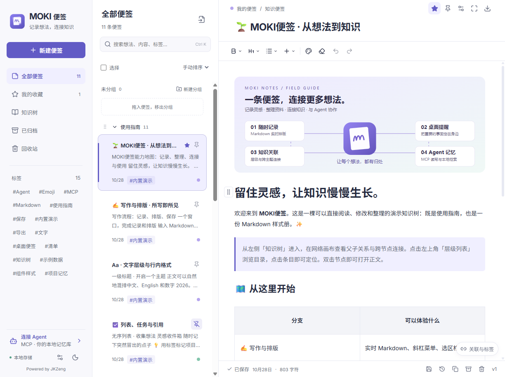
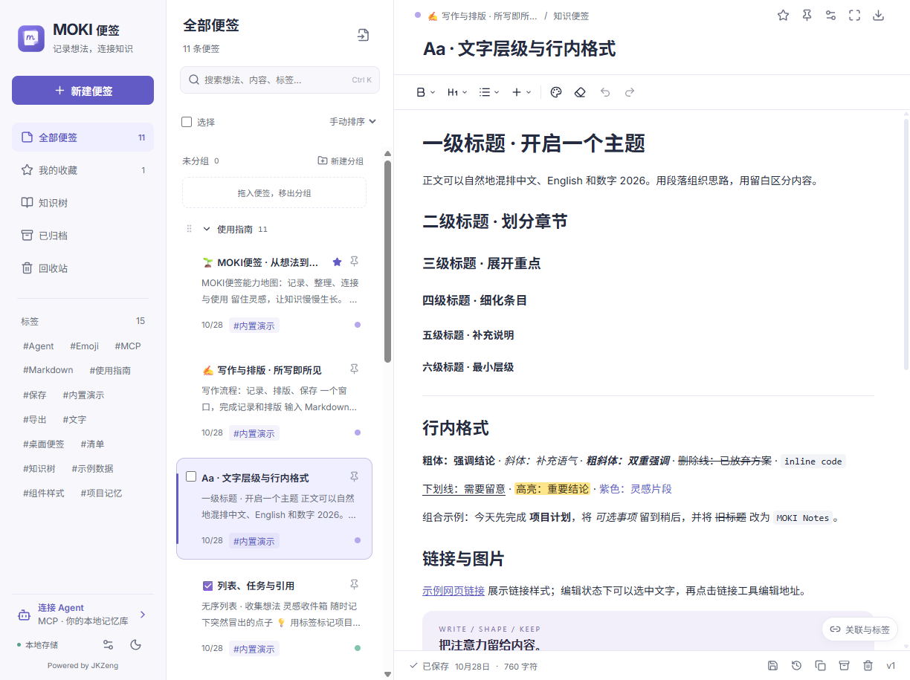
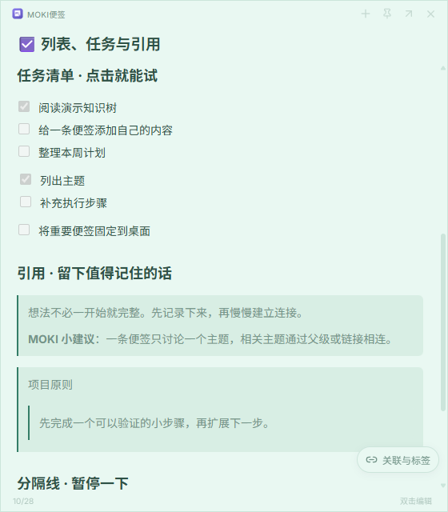
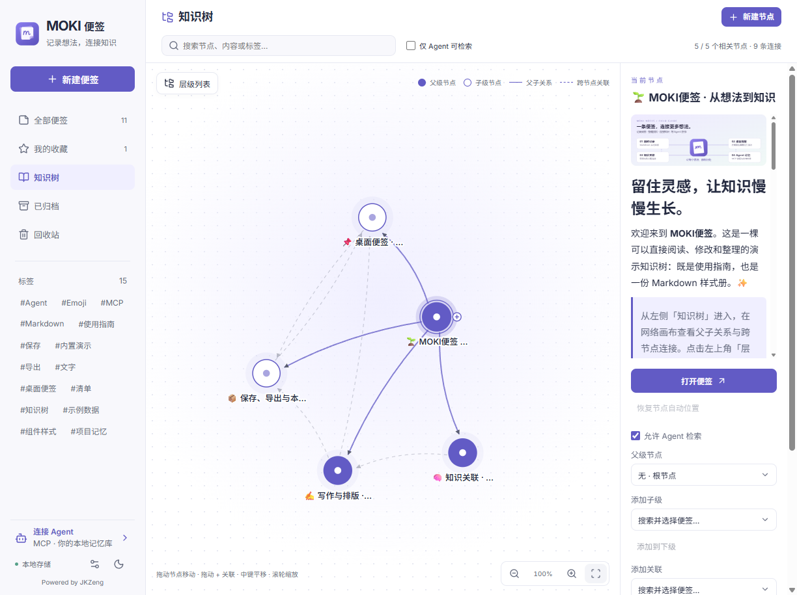
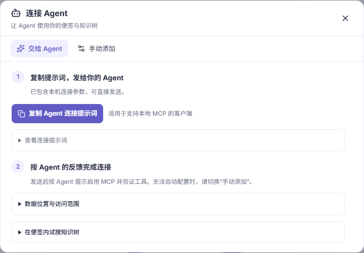
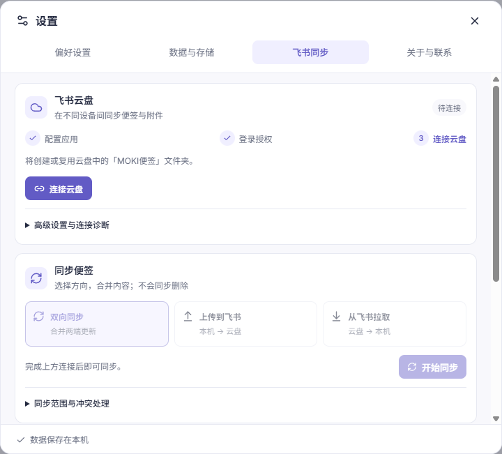

# MOKI Notes · MOKI便签

[简体中文](README.zh-CN.md) · English

**Capture an idea. Pin it to your desktop. Connect it to what you know.**

MOKI Notes is a local Markdown notes app with desktop sticky cards, an explicit knowledge graph, attachments, Feishu/Lark sync, and a local MCP server for your Agent. It runs independently of MOKI Workbench and MOKI Whiteboard.



## What you can do

- **Write and arrange.** Live Markdown formatting, slash commands, headings, tasks, tables, code, LaTeX, block dragging, and multi-column layouts.
- **Pin a note.** Movable, resizable desktop cards stay available when the main window is hidden in the tray. Double-click to edit; toggle always-on-top.
- **Connect knowledge.** Parent/child hierarchy, tags, cross-note links, and a graph you can pan, zoom, and expand. List groups are separate from knowledge relationships.
- **Work with an Agent.** Local stdio MCP tools search, read, create, update, and retrieve context with source URIs and versions. Updates use optimistic version checks.
- **Keep the material together.** Insert images, files, web links, media, and other notes. Store attachments locally and export notes as TXT / Markdown / DOCX.
- **Save and move.** Autosave, local drafts, version history, trash recovery, and a complete `.mokinotes` migration package including attachments.
- **Sync with Feishu/Lark.** Authorize and connect a Drive folder, then upload, pull, or sync both ways; optional scheduled sync runs while the app is running.

| Live Markdown | Desktop sticky card |
| --- | --- |
|  |  |





Screenshots show the real Windows app with its editable built-in guide. The included reading-club project is fictional demo content. The Feishu screenshot shows the connection interface, not a completed sync.

## Download and install (Windows x64)

Version 0.1.1 adds context actions in enlarged image previews, image/file clipboard copying, minute-level edit times, and Windows update fixes. [Release notes](docs/releases/0.1.1.md).

**[Download MOKI Notes 0.1.1 installer](https://github.com/JKZeng-cell/moki-notes/releases/download/v0.1.1/MOKI-Notes-Setup-0.1.1-x64.exe)** · [All releases and checksums](https://github.com/JKZeng-cell/moki-notes/releases/latest)

Download the `.exe`, run the setup wizard, choose an install location, and launch the app. The installer includes the application runtime and Feishu/Lark CLI; regular installation does not require Node.js or npm. Feishu sync still requires your own authorization and configuration in the app.

The current installer is unsigned, so Windows may show an unknown-publisher prompt. Each release includes `SHA256SUMS.txt` to verify the download. Only a Windows x64 installer is currently provided; macOS/Linux desktop behavior and installers have not been verified or released.

## Get the source and run

Requires **Node.js 24 or later** and npm.

```sh
git clone https://github.com/JKZeng-cell/moki-notes.git
cd moki-notes
npm ci
npm run desktop
```

The desktop command builds the app and launches Electron. Windows users can also install the downloadable setup package without a source-development environment. Windows desktop behavior is locally tested. macOS and Linux paths exist, but desktop builds and behavior on those systems are not verified.

For a browser UI:

```sh
npm run build
npm start
# http://127.0.0.1:4331
```

Or use `npm run dev` for the Vite UI at `http://127.0.0.1:4330` and API at port 4331. Desktop pinning requires Electron. The UI and built-in guide are currently in Simplified Chinese; the project introduction is bilingual.

## Connect an Agent

Open **连接 Agent** in the app. Copy the Agent connection prompt, or choose manual setup and copy the command, arguments, and environment variables into a client that supports **local stdio MCP**. Copying a prompt alone does not establish a connection.

For a source checkout after `npm run build`, a generic configuration is:

```json
{
  "mcpServers": {
    "moki-notes": {
      "command": "node",
      "args": ["/absolute/path/to/moki-notes/dist/mcp/server.js"],
      "env": { "MOKI_NOTES_DATA": "/absolute/path/to/moki-notes.db" }
    }
  }
}
```

Use the app-generated values for your actual installation. Merge this entry with existing MCP configuration. Start with `notes_list` for a read-only check. Use `notes_read` before an update, pass `expectedVersion`, then read back the result. `notes_context` searches explicit local keywords; this is not a vector database or automatic semantic graph.

Remote note capture requires a separately configured remote Agent that can reach the note computer. That computer must stay on and reachable; MOKI Notes does not expose a public remote-write service by default.

## Data, sync, and exports

- The app stores SQLite data and attachments on your computer. Data and drafts are local plaintext, not end-to-end encrypted.
- Windows default: `%APPDATA%/moki-notes/moki-notes.db`. macOS: `~/Library/Application Support/moki-notes/moki-notes.db`. Linux: `$XDG_DATA_HOME/moki-notes/moki-notes.db` or `~/.local/share/moki-notes/moki-notes.db`.
- `MOKI_NOTES_DATA` selects a database; `MOKI_NOTES_PROFILE` selects an isolated desktop profile. The desktop HTTP service listens on loopback, port 4332 by default; the standalone server uses 4331.
- Prefer **设置 → 数据与存储 → 导出全部数据** for complete migration. Plain Markdown exports preserve links, not attachment binaries. MOKI-specific column/table styles may render differently in other Markdown apps.
- Agent retrieval settings control search inclusion, not access authorization. A configured local MCP client can read notes by ID, including archived and trashed notes.
- Feishu sync needs your own authorization/configuration. It does not propagate deletions; simultaneous changes retain a conflict copy. Native Feishu docs and non-Markdown files are pull-only. Full exit stops scheduled sync.
- Windows packaging downloads the pinned official Feishu CLI and checks its hash. It is not stored in this source repository. Other systems need a compatible local `lark-cli` for sync.



## Development

```sh
npm run typecheck
npm test
npm run build
npm run test:mcp
```

`npm run check` combines type checking, tests, and the build. MCP smoke tests use an isolated temporary database. On Windows, `npm run package:installer` creates a local NSIS installer; packaging is separate from publishing and does not sign or notarize the app.

The source is organized under `src/web`, `src/server`, `src/desktop`, `src/mcp`, and `src/shared`. See [CONTRIBUTING.md](CONTRIBUTING.md) for contributions and [THIRD_PARTY_NOTICES.md](THIRD_PARTY_NOTICES.md) for fonts and bundled-tool licensing.

## License and contact

Project source: [MIT License](LICENSE). Third-party components retain their own licenses. Developer: **MOKI / JKZeng** · [jkzeng@moge.tv](mailto:jkzeng@moge.tv). Feature requests and reproducible bug reports are welcome in [Issues](https://github.com/JKZeng-cell/moki-notes/issues).
